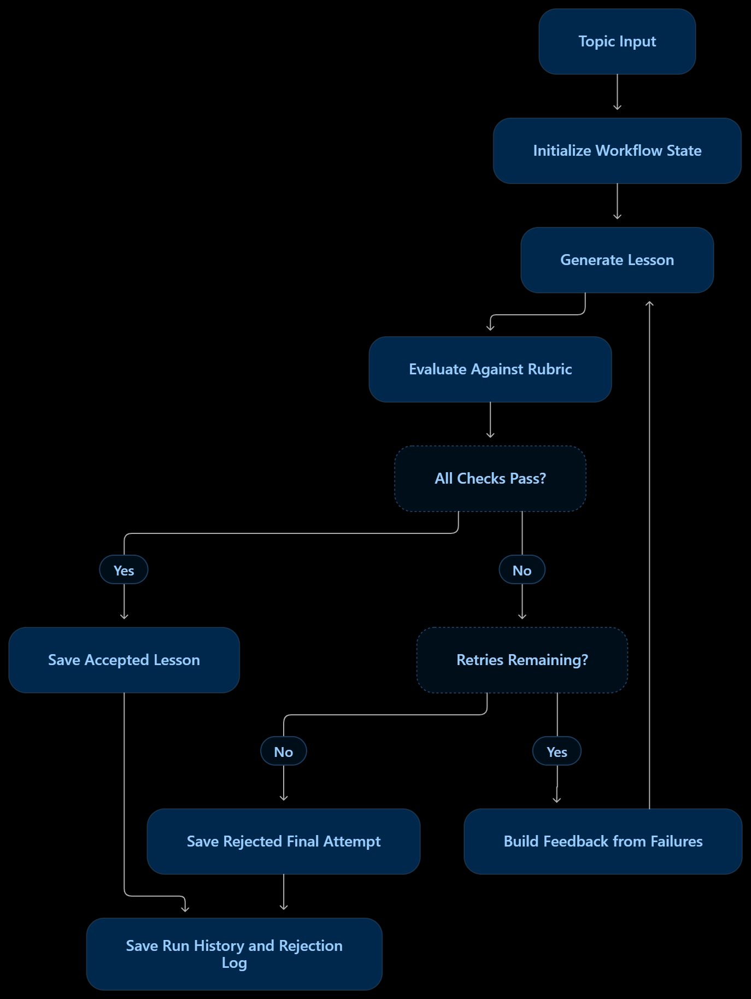

# Lesson Foundry

A Streamlit app using LangChain chat models and a LangGraph state machine to create a beginner lesson, check it against a hard pass/fail rubric, and retry with specific rejection reasons. It is designed for the assignment topic, **Introduction to RAG**, but accepts any topic.

## Run locally

Requires Python 3.11 or newer.

```powershell
py -m venv .venv
.venv\Scripts\Activate.ps1
python -m pip install -r requirements.txt
Copy-Item .env.example .env
streamlit run main.py
```

The app uses Groq. Enter its API key in the sidebar or set `GROQ_API_KEY` in `.env`. The initial topic is Introduction to RAG, and the default model is `openai/gpt-oss-120b`; change the model field if needed.

## How the system works



1. **Generate:** the LangGraph `generate` node calls a LangChain chat model with the existing teaching prompt for a zero-background learner.
2. **Evaluate:** the `evaluate` node makes a separate model call against the same six binary checkpoints: accuracy and grounding, beginner language, worked example, explained jargon, complete coverage, and coherent flow. A checkpoint passes only when the evaluator returns an explicit boolean `true`.
3. **Regenerate:** a conditional graph edge ends on a pass or exhausted retry limit; otherwise it returns to `generate` with failed-check reasons and evaluator suggestions. Choose up to three retries, for a strict maximum of four drafts. The UI reports when it is generating, evaluating, retrying, and when the rubric has passed or the retry limit is exhausted.
4. **Remember:** SQLite stores drafts, evaluations, outcomes, and human feedback across app restarts. Repeated rubric failures and recent feedback become compact guidance for later generations.

The rejection log shows each draft, the failed checks, and whether their reasons were sent forward. A failed final draft is labeled **DID NOT PASS** rather than being presented as approved. Lessons can include a small text diagram or table when useful and can be downloaded as Markdown; the app does not generate image assets.

## Design choices and limits

- The generator and evaluator are separate calls with different instructions; using the same selected model keeps setup simple, but does not make the evaluator truly independent. For higher assurance, use a separately selected judge model or provider.
- The accuracy checkpoint is a model judgment, not external fact verification. The generator is told not to invent citations; important lessons still need human review and trusted sources.
- All checks are hard gates: no averaging hides a failure. Retries are bounded to control cost and prevent endless loops.
- SQLite was chosen over a vector database because the memory is structured run history and concise feedback, not semantic document retrieval. Configure another path with `LESSON_MEMORY_DB`.
- API keys are not written to the run database. For deployment, use Streamlit secrets or a managed secret store and protect the app with authentication.

## Future improvements

With more time, I would like to extend the project with:

- **A polished frontend:** Build a cleaner, more interactive interface with smooth transitions using React or Next.js.
- **Observability:** Integrate LangSmith to trace model calls, inspect runs, and identify issues in lesson generation and evaluation.
- **Faster responses:** Offer paid API providers or models as an option, and measure their latency and quality against the current setup.
- **PDF downloads:** Let users download generated lessons as PDF, in addition to the existing Markdown download.
- **Scalable history storage:** Consider PostgreSQL for deployments that need concurrent users and more robust, long-term history storage.
- **Multiple chat threads:** Let users create and switch between separate conversations, each with its own lesson history.
- **More improvements:** Add features based on user feedback and the needs of future deployments.

## Tests

Run the provider-independent pipeline and persistence tests with:

```powershell
python -m unittest -v
```
